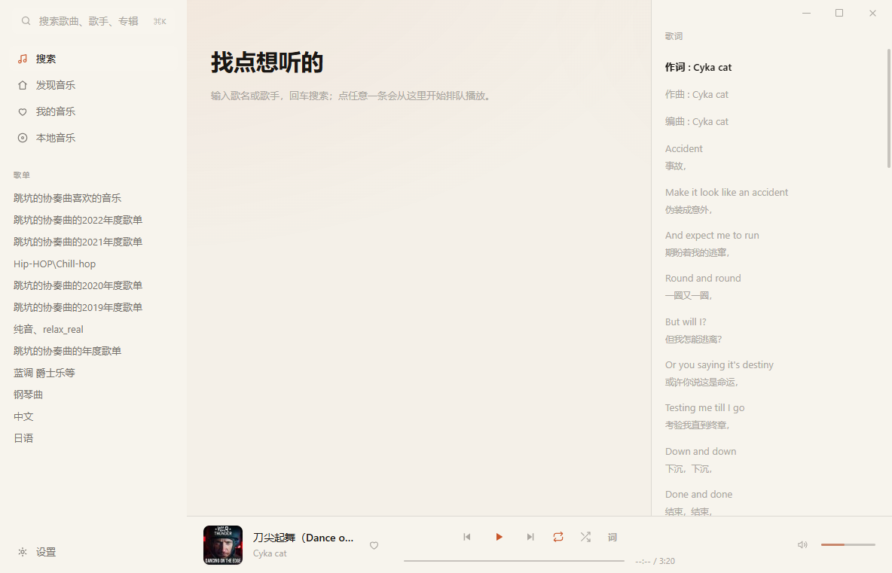
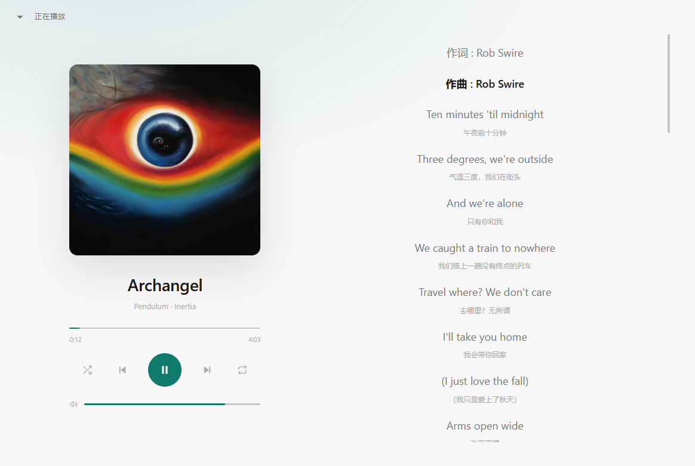
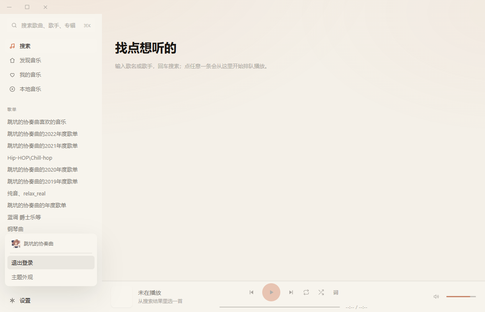
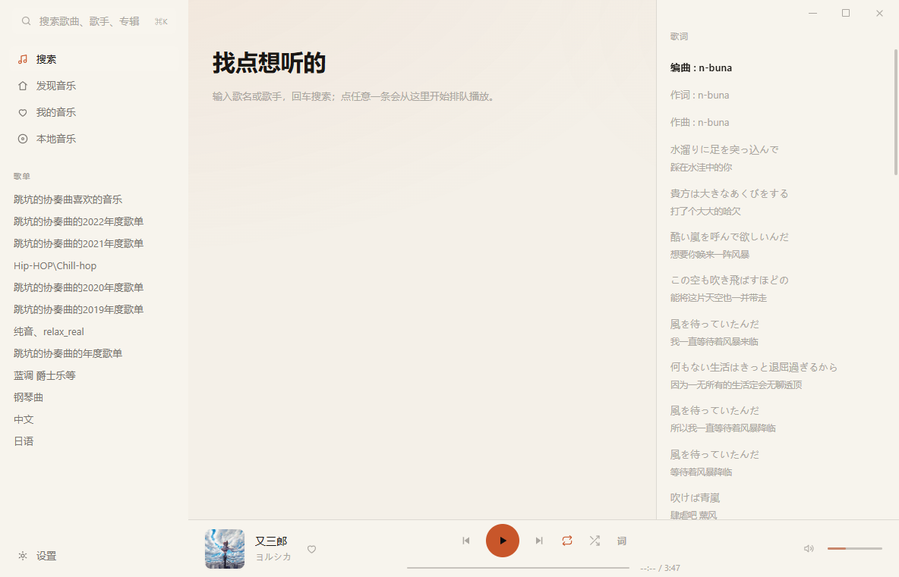

# Manbamusic

一个用 Rust 写的第三方网易云音乐桌面播放器。**Tauri v2 + Svelte 5 薄前端 + 厚 Rust 后端**：协议、音频、歌词、系统集成全在 Rust，前端只做渲染和交互。

> 个人自用项目，只调用官方 Web 接口，不涉及音源替换、DRM 破解或账号共享。



<details>
<summary>更多截图</summary>

**正在播放（全窗口大封面）**



**设置菜单**



**歌单加载骨架屏**



</details>

## 功能

**播放**

- 搜索歌曲（云搜索接口，带封面/专辑/时长）
- 队列播放：点任意一首从那里开始排队，播完自动下一首
- 上/下一首、列表循环、单曲循环、随机
- **无缝切歌**：下一首提前预挂载进解码队列，切歌不等网络
- 直链缓存（按接口给的 `expi` 过期，切歌不重复请求）
- 无损/高解析音质选择，未登录 VIP 曲目会识别为试听
- 音量：拖动、滚轮、方向键、点喇叭静音

**界面**

- 自绘无边框窗口 + 标题栏浮层（最小化/最大化/关闭、拖动）
- 浅色 / 深色共 6 套主题，全部由 4 个种子色自动派生
- 虚拟滚动列表：1000 首以上只渲染视口内约 20 行
- 全窗口「正在播放」页：大封面 + 控制簇 + 歌词
- 歌词：YRC 逐字优先、回落 LRC、合并翻译，按播放位置滚动高亮
- 桌面歌词窗：无边框、透明置顶、点击穿透

**账号**

- 扫码登录，`MUSIC_U` 落盘到数据目录，下次启动自动恢复
- 我的歌单（含官方「我喜欢的音乐」）
- 收藏红心：与网页端同一个接口，双向同步

**持久化**

- 重启后恢复音量、循环/随机模式、整条播放队列与当前位置
- 状态存在 `<data>/state.json`

## 技术栈

| 层 | 选型 |
| --- | --- |
| 桌面外壳 | Tauri v2 |
| 前端 | Svelte 5（runes）+ Vite 8 + TypeScript 5.9 |
| 音频 | rodio 0.23 + stream-download 0.24 |
| 异步运行时 | tokio |
| 系统集成 | souvlaki（媒体键 / SMTC）、Tauri 托盘 |
| 协议 | weapi（AES-CBC×2 + RSA）/ eapi，自维护 Cookie 表 |

## 快速开始

需要 Rust（MSVC 工具链）与 Node 20+。

```bash
# 1. 装前端依赖
cd apps/desktop && npm install

# 2. 构建前端（产物会被嵌进二进制）
npm run build

# 3. 跑桌面端
cd ../.. && cargo run -p manbamusic-desktop --features custom-protocol
```

只调样式时可以用浏览器看 UI（走 mock 数据）：

```bash
cd apps/desktop && npm run dev
```

### 常用命令

```bash
cargo test --workspace                     # 单元测试
cargo clippy --workspace --all-targets -- -D warnings
cd apps/desktop && npm run check           # svelte-check
cargo run -p ncm-cli -- search 晴天 --limit 5
cargo run -p ncm-cli -- url 26259733
```

### 数据目录

默认 `%LOCALAPPDATA%\Manbamusic`（WebView 数据、下载缓存、`login.json`、`state.json`）。
用环境变量可覆盖：`MANBAMUSIC_DATA_DIR=E:\some\dir`。

## 目录结构

```
crates/
  ncm-api/       协议层：weapi/eapi 加密、Cookie 会话、搜索/直链/歌词/登录/红心
  ncm-audio/     音频管线：stream-download 拉流 + rodio 解码
  ncm-core/      播放器 actor（命令通道 + 状态快照 + 播完事件）
  ncm-lyrics/    歌词解析：LRC / YRC 逐字 / 翻译合并
  ncm-platform/  系统媒体键（souvlaki）
apps/
  desktop/       Tauri 外壳 + Svelte 前端
  cli/           命令行小工具（协议与播放探针）
```

依赖方向严格单向：`desktop/cli → ncm-api / ncm-audio / ncm-core / ncm-lyrics / ncm-platform`，`ncm-core → ncm-audio`。

## 架构要点

- **三线程**：WebView（渲染）、tokio（网络与命令）、独占音频线程（`MixerDeviceSink` 不是 `Send`）。外部只能给播放器发命令、读快照。
- **无缝切歌**：预挂载状态下 `player.empty()` 恒为 false，换曲判断依赖 `TrackTap` 上报的 `TrackEnded`。
- **IPC**：前端每 400ms 轮询播放快照，进度条用 CSS 过渡抹平 400ms 的跳变。
- **主题**：组件只写 `var(--token)`，换主题 = 改 `:root` 变量，不重新渲染。

更完整的协议细节、线程模型与踩坑记录见 [ARCHITECTURE.md](ARCHITECTURE.md)。

## 已知限制

- 单个歌单最多取 5000 首（接口分页上限内的保护值）。
- 尚未做下载/离线、本地音乐扫描、每日推荐、歌单编辑。
- 桌面歌词窗固定浅色文字（不跟随主题）。
- 自定义主题与界面偏好仍存在 WebView 的 localStorage，尚未落盘到数据目录。
- 无 CI、无自动打包与签名。

## 路线图

- [ ] 待播队列视图（当前队列可见但未做成面板）
- [ ] 下载与离线播放（需要新 crate `ncm-store` 做持久化）
- [ ] 本地音乐扫描（`lofty` 读标签）
- [ ] 每日推荐 / 歌单管理（写操作需要 `__csrf`）
- [ ] 设置页与配置落盘
- [ ] 打包、签名、自动更新

## 声明

仅供个人学习与自用。所有音乐内容版权归网易云音乐及对应版权方所有，本项目不提供任何音源，也不绕过付费与版权限制。使用产生的任何后果由使用者自行承担。

## 许可证

尚未选择许可证。如需使用请先联系作者。
